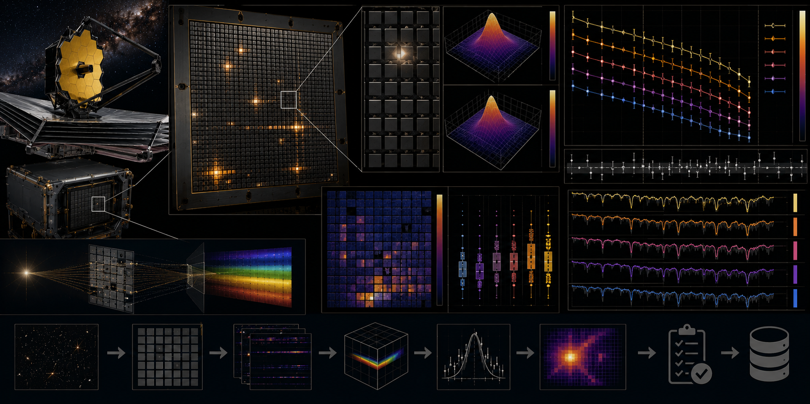

# JWST/NIRSpec Micro-Shutter Throughput Loss Sandbox



> **Curation:** `BUILD_FIRST` · Priority 9.0/10 · official instrument parameters + synthetic Monte Carlo

## Research evidence and downloads


- [Download the machine-readable table profiles](evidence/table-profiles.json) for 3 archived tables. Open `table-evidence.html` from the checkout for the coverage chart.
- Start with [Summary](results/summary.json), [Sensitivity](results/sensitivity.json), [Sensitivity designs](results/sensitivity_designs.csv).
- [View Fig01 msa geometry](figures/fig01_msa_geometry.png).

To rebuild the table profiles after rebuilding the evidence inventory, run `python scripts/profile_evidence_tables.py` followed by `python scripts/render_table_profiles.py`.

[Open the evidence browser file](evidence.html) for 14 selected files, including [`summary.json`](results/summary.json). Each file has a download link and SHA-256 digest. Serve this checkout with `python -m http.server` to view the static browser.

Rebuild the inventory and browser with `python scripts/evidence_catalog.py` and `python scripts/render_evidence_page.py`.

## Scientific question

Conditional on a planned MSA shutter opening, how do target-centering error and wavelength-dependent PSF width alter simplified geometric slit throughput, and how large is the separate penalty under a conservative 4% random command-failure scenario?

## What this repository contributes

An instrument-physics QA sandbox; not a replacement for the JWST pipeline or official path-loss corrections.

## Key result

The former 0.7795 headline is retired. It multiplied conditional geometric slit transmission by a 2022 aggregate operability fraction, even though APT/MPT uses a position-specific map to plan targets into viable shutters. In the corrected 20,000-trial model, mean geometric throughput conditional on command success is **0.9490** (Monte Carlo 95% interval 0.9482–0.9499). A separate conservative 4% random non-opening scenario gives mean effective throughput **0.9100**; this is a model scenario, not a forecast for a planned target. See [SCIENTIFIC_AUDIT.md](SCIENTIFIC_AUDIT.md).

## Reproducing this result

```bash
python -m venv .venv
# Windows PowerShell
.venv\Scripts\Activate.ps1
python -m pip install -e ".[dev]"
pytest -q
python scripts/run_analysis.py --demo
python scripts/make_figures.py --demo
```

The demo path above uses a small trial count for a fast smoke test. The production Monte Carlo result quoted above is `python scripts/run_analysis.py` (no `--demo`), which uses the full 20,000-trial configuration in `config/analysis.yml`.

For the web dashboard:

```bash
cd web-react
npm install
npm run dev
```

## Research documentation

- `CURATION_STATUS.md`
- `docs/RESEARCH_BLUEPRINT.md`
- `docs/DATASET_PLAN.md`
- `docs/LITERATURE_SEEDS.md`
- `docs/VALIDATION_CONTRACT.md`
- `docs/FIGURE_AND_UI_SPEC.md`

## Reproducibility and FAIR practice

This project uses verified official instrument parameters rather than downloaded archive products (documented explicitly, not a substitute presented as archive data). Derived results record the software commit and configuration hash.

## Limitations

- An instrument-physics QA sandbox using official published parameters and a Monte Carlo forward model; not a replacement for the JWST pipeline or official path-loss corrections, and not a fit to real observed spectra.
- Shutter-open/closed and centering-error distributions are simplified, documented assumptions, not measured from real exposures.
- Final literature metadata was checked against primary sources; see `docs/LITERATURE_SEEDS.md` for any items still marked `VERIFICATION_PENDING`.

## Author

Biswajit Jana

## Licence

BSD-3-Clause for original code. Instrument parameter sources retain their original terms.
